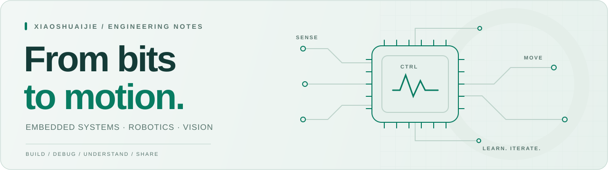

<picture>
  <source media="(prefers-color-scheme: dark)" srcset="./assets/header-dark.svg">
  <source media="(prefers-color-scheme: light)" srcset="./assets/header-light.svg">
  
</picture>

<h1 align="center">Hi, I'm jie 👋</h1>

  在嵌入式、视觉与运动控制之间探索，把想法做成能运行的作品。 
  Build things. Understand how they work. Share what you learn.

  <a href="https://happyjie.cc">杰的小站 ↗</a>
  &nbsp; · &nbsp;
  <a href="https://github.com/xiaoshuaijie?tab=repositories">全部项目 ↗</a>
  &nbsp; · &nbsp;
  <a href="https://github.com/xiaoshuaijie/cmake">开发环境教程 ↗</a>

---

## 关于我

你好，我是 **jie**。喜欢折腾单片机、相机和电机，也喜欢把开发中踩过的坑整理成别人能用上的记录。

- **嵌入式开发**：围绕 STM32，实践外设驱动、实时任务与设备通信。
- **视觉与控制**：从相机里的钢球位置，到控制器里的反馈，再到电机的实际动作。
- **工具与分享**：整理 CMake 工程和调试工作流，让构建、下载与排查问题更顺手。

## 精选项目

### 01 / 从构建到调试

**[STM32 CMake 开发环境教程 →](https://github.com/xiaoshuaijie/cmake)**

整理 STM32 工程在 CLion、VS Code 下的构建、下载与调试流程，覆盖 OpenOCD、J-Link、DAPLink、ST-Link 和 Ozone。希望让第一次配置环境的人，也能顺利走到断点停下来的那一步。

`STM32` `CMake` `CLion` `VS Code` `OpenOCD` `Ozone`

### 02 / 让视觉参与控制

**[STM32 平衡滚球控制系统 →](https://github.com/xiaoshuaijie/STM32407ZGT6)**

基于 STM32F407、FreeRTOS 与 LibXR，将视觉位置接收、PID 平衡控制、闭环步进电机驱动和 LCD 交互串成一条完整的反馈链路。

`C / C++` `STM32F407` `FreeRTOS` `LibXR` `PID`

### 03 / 看清运动中的钢球

**[MaixCAM 钢球识别与跟踪 →](https://github.com/xiaoshuaijie/yolo11_26_diansa)**

面向 MaixCAM 系列设备，结合 YOLO 检测、模板跟踪与图像增强，处理短暂漏检、光照变化和快速移动后的重定位，为控制端提供位置测量。

`Python` `MaixCAM` `YOLO` `NPU + CPU` `目标跟踪`

  更多视觉实践：<a href="https://github.com/xiaoshuaijie/maxican_25_diansai">MaixCAM Pro 电赛视觉代码 ↗</a>

## 常用技术与工具

| 方&nbsp;向 | 项目中使用的技术 |
| :--- | :--- |
| 固&nbsp;件 | C / C++ · STM32 · FreeRTOS · LibXR · PID |
| 视&nbsp;觉 | Python · MaixCAM · YOLO · 模板匹配 |
| 构&nbsp;建 | CMake · Ninja · STM32CubeMX · Git |
| 调&nbsp;试 | CLion · VS Code · OpenOCD · J-Link · ST-Link · Ozone |

## 记录与交流

我把项目代码留在 GitHub，也在 **[杰的小站](https://happyjie.cc)** 记录学习和折腾的过程。

如果你也在做嵌入式、视觉或控制相关的项目，欢迎到对应仓库的 Issues 交流实现思路、遇到的问题和改进建议。

## GitHub 概览

  <a href="https://github.com/xiaoshuaijie?tab=repositories">
    <picture>
      <source media="(prefers-color-scheme: dark)" srcset="https://github-stats-extended.vercel.app/api?username=xiaoshuaijie&amp;rank_icon=percentile&amp;show_icons=true&amp;include_all_commits=true&amp;theme=github_dark&amp;hide_border=true&amp;disable_animations=true">
      <source media="(prefers-color-scheme: light)" srcset="https://github-stats-extended.vercel.app/api?username=xiaoshuaijie&amp;rank_icon=percentile&amp;show_icons=true&amp;include_all_commits=true&amp;theme=light_github&amp;hide_border=true&amp;disable_animations=true">
      
    </picture>
  </a>

保持好奇，持续动手。 · Stay curious. Keep building.

